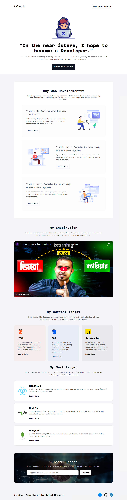

# 🚀 Responsive Web Design Assignment | Programming Hero

[](https://awlad-h.netlify.app/)


This repository contains my submission for the first assignment of the Programming Hero Web Development Course (Batch 10). The project is a personal portfolio website built from the ground up, demonstrating a solid understanding of HTML5, CSS3, and modern responsive design principles.

## 🌐 Live Preview
🔗 **[https://awlad-h.netlify.app/](https://awlad-h.netlify.app/)**

## 🖼️ Screenshot
A preview of the deployed project:


## 📌 About This Project
This project is a testament to the foundational skills acquired in the early modules of the Programming Hero course. It's a single-page portfolio website designed to be visually appealing and fully functional across all modern devices, from mobile phones to desktop screens. The focus was on writing clean, semantic HTML and well-structured, maintainable CSS.

## 🎯 Key Learning Objectives
- **Semantic HTML5:** Structuring web content meaningfully for accessibility and SEO.
- **Modern CSS3:** Applying advanced styling, including custom properties (variables), for a clean and professional look.
- **Responsive Design:** Using Flexbox, CSS Grid, and media queries to create a fluid layout that adapts to any screen size.
- **Mobile-First Approach:** Prioritizing the design and functionality for mobile users.
- **Version Control:** Utilizing Git and GitHub for tracking changes and managing the codebase.
- **Deployment:** Hosting the final project on a live server with Netlify.

## 🛠️ Technologies Used
| Technology | Purpose |
|------------|---------|
| **HTML5** | For semantic content structure. |
| **CSS3** | For styling, layout, and responsive design. |
| **Flexbox & Grid** | For creating modern, sophisticated layouts. |
| **Media Queries**| For device-specific styling rules. |
| **Git & GitHub** | For version control and code hosting. |
| **Netlify** | For continuous deployment and hosting. |

## 📂 Project Structure
Here is an overview of the file structure:
```
B10_Assignment-1/
├── assets/
│   ├── icons/
│   │   ├── facebook.png
│   │   └── linkedin-icon 1.png
│   └── images/
│       ├── css.png
│       ├── Group 3.png
│       ├── Group 4.png
│       ├── Group.png
│       ├── handshake.jpg
│       ├── Hero-bg.png
│       ├── html.png
│       ├── js.png
│       ├── Layer_1.png
│       ├── mongodb.png
│       ├── nodejs.png
│       └── react.png
├── styles/
│   ├── main.css
│   └── responsive.css
├── .gitattributes
├── index.html
└── README.md
```

## 🚀 How To Get Started
To explore this project on your local machine, follow these steps:

1. **Clone the repository:**
   ```bash
   git clone https://github.com/alamin247khan/B10_Assignment-1.git
   ```
2. **Navigate to the project directory:**
   ```bash
   cd B10_Assignment-1
   ```
3. **Open `index.html` in your web browser.**

No special tools or installations are required to run this project.

## 🙏 Acknowledgements
A special thank you to the entire [Programming Hero](https://web.programming-hero.com/) team and our mentors for their invaluable guidance and support. This assignment has been a fantastic learning experience. 